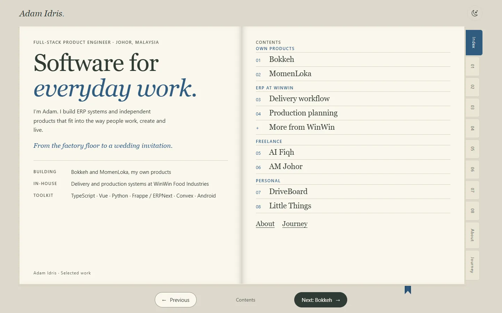
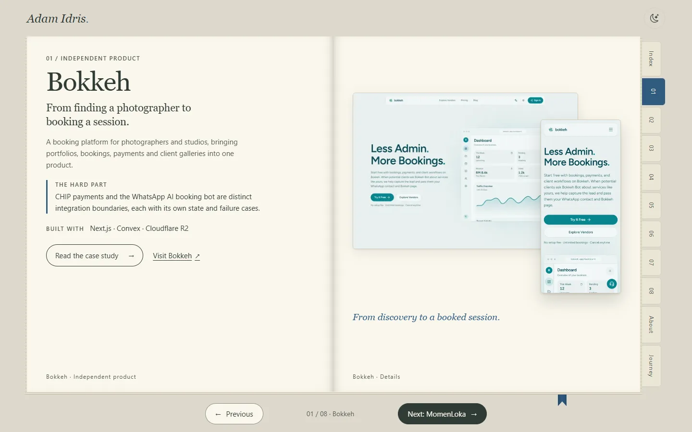
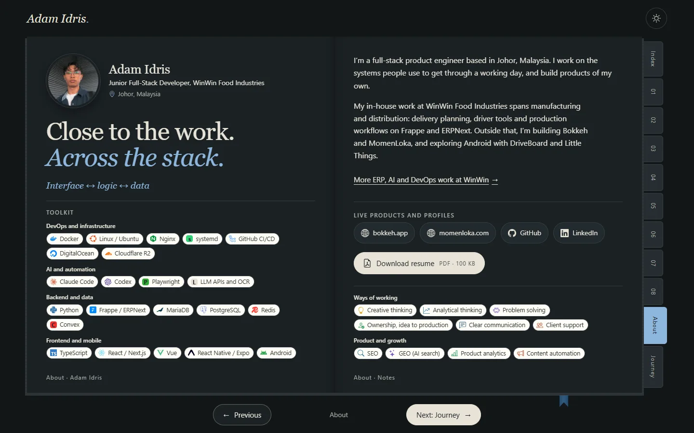
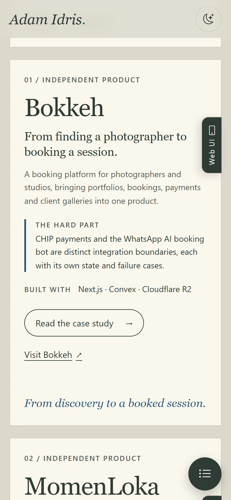

# Adam Idris: portfolio

My personal portfolio, live at **[adamidris.pages.dev](https://adamidris.pages.dev)**.

I'm a full-stack developer in Johor, Malaysia. I build ERP systems at WinWin Food Industries and my own products (Bokkeh, MomenLoka), and I'm moving toward DevOps and AI agents for company use. This repo is the site's source code. It is a static Astro site, built and checked with the scripts below.

| Desktop: contents | Desktop: a project spread |
| --- | --- |
|  |  |
| **Dark mode: About** | **Phone** |
|  |  |

## What to look at

- **Desktop layout (1001px and wider).** The site is a book with 3D page turns. It opens from a cover, has fore-edge tabs, Previous/Next controls and arrow keys, and ends with a back cover holding a timeline. Each spread updates the URL, so Back works and any spread can be deep-linked.
- **Phones, tablets and no JavaScript.** One scrolling page with a sticky header and a floating contents menu. On phones, a pull-out drawer on the right edge shows each project's phone UI (swipeable for apps with several screens).
- **25 case studies.** 8 main projects, plus 17 ERP systems under [More from WinWin](https://adamidris.pages.dev/work/winwin/). Employer work is described in words and flow diagrams only. No internal screens, names, hosts or amounts.
- **Playful extras.** These include:
  - rubber stamps, tape and handwritten scribbles on the project pages
  - a terminal easter egg: press <kbd>`</kbd> or click `>_`, then try `help`, `git log`, `docker ps` or `sudo hire-me`
  - a bookmark ribbon that opens a random project, and confetti on the back cover
  - optional page-turn and stamp sounds, generated with Web Audio, so there are no audio files
- **Dark mode** with a circular reveal (View Transitions API).
- **Accessibility:** a live region announces page turns, and hidden faces are made inert. Reduced motion turns off animation, and all text is at least 12px.

## Stack and approach

- [Astro 5](https://astro.build) static output. The only dependency is Astro itself.
- Plain CSS in one stylesheet ([`src/styles/global.css`](src/styles/global.css)). The phone layout is the default; the book is added inside `@media (min-width: 1001px)`.
- Native platform features: the Popover API for menus and drawers, `:has()`, `color-mix()`, `svh` units, `@starting-style`, and View Transitions.
- Images go through `astro:assets`, which resizes them to WebP at build time.
- Hosted on Cloudflare Pages.

## Project layout

| Path | What |
| --- | --- |
| [`src/data/`](src/data) | Content as plain data: projects, journey timeline, skills, ERP index. |
| [`src/pages/index.astro`](src/pages/index.astro) | Homepage markup and the book script. |
| [`src/pages/work/`](src/pages/work) | Case studies in Markdown (frontmatter feeds the "At a glance" block). |
| [`src/layouts/`](src/layouts) | Base page, case study and ERP case-study layouts. |
| [`src/components/`](src/components) | Screenshots, gallery, flow diagram, icons. |
| [`scripts/`](scripts) | Source checks and Playwright browser checks. |

## Run it

```sh
npm install
npm run dev        # http://127.0.0.1:4321
npm run build      # static site in dist/
```

## Checks

```sh
npm run build && npx astro preview --host 127.0.0.1 --port 4321
VERIFY_URL=http://127.0.0.1:4321 npm run verify         # content and privacy checks, every route and asset returns 200
VERIFY_URL=http://127.0.0.1:4321 npm run check:browser  # Playwright at 9 viewport sizes
```

`check:browser` needs Playwright; set `PLAYWRIGHT_MODULE` to its `index.mjs` if it isn't installed in the usual place. It runs at nine sizes from 320×640 to 1536×864. At each size it checks:

- no horizontal scroll, one `h1`, every image loaded, no text under 12px
- on desktop: every spread fits on screen, tabs, keys, Back, deep links, and the switch back to the phone layout when the window is resized
- reduced motion and no-JavaScript runs

## Credits

Icons from [Simple Icons](https://simpleicons.org) (CC0) and [Bootstrap Icons](https://icons.getbootstrap.com) (MIT). Company and university logos belong to their owners.

The code is here for review. The writing, photos, screenshots and resume are mine; please don't reuse them.
